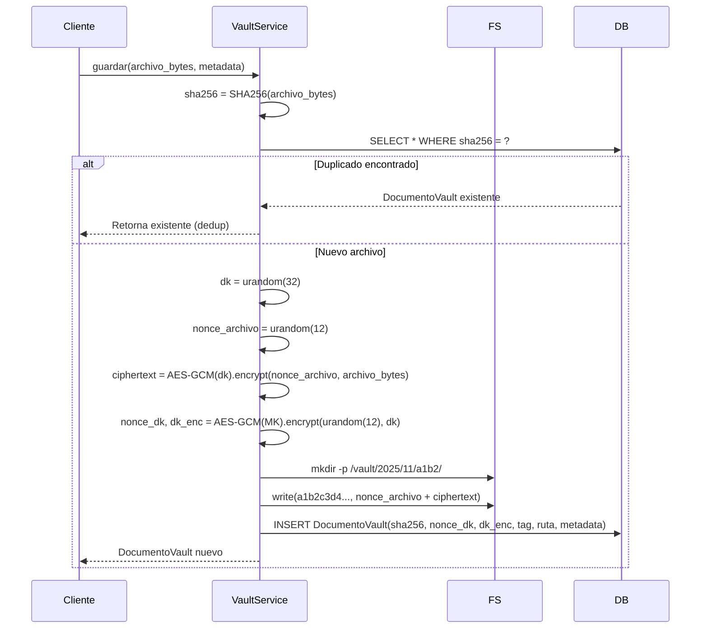
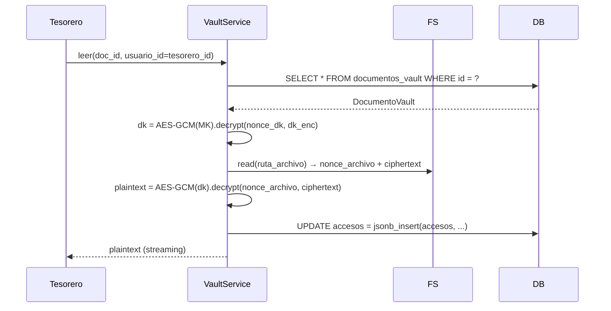

# FTD-006: Bóveda de Documentos Cifrada (AES-256 at-rest)

## Intent

Implementar almacenamiento cifrado **transparente** para todos los archivos del sistema. Cada archivo se cifra con una **Document Key (DK)** única derivada aleatoriamente, y la DK se cifra con una **Master Key (MK)** rotativa. Proporciona: confidencialidad en reposo, integridad (AES-GCM), deduplicación por contenido, auditoría de accesos y rotación de claves sin downtime.

## Scope

### Incluido

**Modelo de datos (`app/models/vault.py`):**
- `DocumentoVault`: tabla principal con metadatos, hash SHA-256, nonce, DK cifrada, tag GCM, ruta archivo, tipo documento, entidad relacionada, auditoría JSON
- `TipoDocumento` enum: `COMPROBANTE`, `BOLETA`, `CONTRATO`, `OTRO`
- Índices: `sha256` (unique), `entidad_relacionada + entidad_id`, `subido_en`

**Servicio Vault (`app/services/vault.py`):**
- `VaultService.guardar(bytes, metadata) -> DocumentoVault`: cifra, deduplica (SHA-256), persiste
- `VaultService.leer(doc_id, usuario_id) -> bytes`: descifra streaming, registra auditoría
- `VaultService.eliminar(doc_id, usuario_id) -> bool`: borra archivo + registro (soft delete opcional)
- `VaultService.rotar_master_key(nueva_mk_b64) -> int`: batch re-cifra todas las DKs, retorna count procesados

**Utilidades cripto (`app/core/crypto.py`):**
- `derive_master_key(password: str, salt: bytes) -> bytes`: PBKDF2-HMAC-SHA256, 100k iteraciones
- `generate_document_key() -> bytes`: `os.urandom(32)`
- `encrypt_aes_gcm(key: bytes, plaintext: bytes) -> (nonce, ciphertext_with_tag)`
- `decrypt_aes_gcm(key: bytes, nonce: bytes, ciphertext_with_tag: bytes) -> bytes`
- `sha256_bytes(data: bytes) -> str`: hex digest

**Configuración (`app/core/config.py`):**
- `VAULT_PATH`: Path base vault (default: `./vault`)
- `MASTER_KEY_B64`: Master Key en base64 (obligatoria en `.env`)
- `VAULT_DEDUP_ENABLED`: bool (default: True)

**Estructura filesystem:**
```
{vault_path}/
  2025/
    01/
      a1b2/          # primeros 4 chars SHA-256
        a1b2c3d4...  # archivo: [nonce:12][ciphertext+tag]
```

**Scripts operativos (`scripts/vault/`):**
- `generar_master_key.py`: genera MK + salt + guarda `.env.example`
- `rotar_master_key.py --nueva-mk <b64>`: ejecuta rotación batch con progreso y verificación
- `verificar_integridad.py`: recorre vault, descifra y verifica SHA-256 match
- `backup_vault.py`: empaqueta vault + exporta MK cifrada (age/GPG)

**Integración con servicios existentes:**
- `ComprobantePago` → `archivo_vault_id` (FK a DocumentoVault)
- `Egreso` → `comprobante_vault_id` (FK)
- `CompraClub` → `documento_vault_id` (FK)
- Migración: script `migrar_archivos_a_vault.py` para archivos legacy en `static/uploads/`

### Excluido

- Cifrado en tránsito (TLS termina en reverse proxy / Uvicorn --ssl)
- HSM / KMS externo (MVP: MK en variable de entorno)
- Versionado de documentos (un archivo = una versión)
- Compartir documentos entre miembros (solo Tesorero/Admin acceden a vault)

## Arquitectura

### Esquema de Cifrado

```
MASTER KEY (MK) ──────────────────────────────────────────┐
  │  Derivada: PBKDF2(password_env, salt_mk, 100k iter)   │
  │  Almacenada: Variable de entorno MASTER_KEY_B64       │
  │  Rotación: Anual (re-cifrado batch programado)        │
  ▼                                                        │
DOCUMENT KEY (DK) — Una por archivo                       │
  │  Generada: os.urandom(32)                             │
  │  Cifrada: AES-256-GCM(MK, DK) → dk_enc (48 bytes)     │
  │  Almacenada: BD (nonce_dk + dk_enc) + archivo (header)│
  ▼                                                        │
ARCHIVO CIFRADO                                           │
  │  Algoritmo: AES-256-GCM (authenticated encryption)    │
  │  Nonce: 12 bytes aleatorios por archivo               │
  │  Formato en disco: [nonce_archivo:12][ciphertext+tag] │
  ▼                                                        │
STORAGE: Local filesystem (configurable path)             │
  │  Estructura: /vault/{año}/{mes}/{sha256_primeros4}/   │
  │  Permisos: 600 (solo user app)                        │
```

### Flujo: Guardar Archivo



### Flujo: Leer Archivo



## Modelo de Datos

```python
# app/models/vault.py
import enum
from sqlalchemy import Column, Integer, String, Text, DateTime, LargeBinary, ForeignKey, Enum, Index, JSON, func
from sqlalchemy.orm import relationship
from app.database import Base

class TipoDocumento(str, enum.Enum):
    COMPROBANTE = "COMPROBANTE"
    BOLETA = "BOLETA"
    CONTRATO = "CONTRATO"
    OTRO = "OTRO"

class DocumentoVault(Base):
    __tablename__ = "documentos_vault"
    
    id = Column(Integer, primary_key=True, autoincrement=True)
    
    # Identidad del contenido (plaintext)
    sha256 = Column(String(64), nullable=False, unique=True, index=True)
    nombre_original = Column(String(300), nullable=False)
    mime_type = Column(String(100), nullable=False)
    tamano_bytes = Column(Integer, nullable=False)
    
    # Cifrado: Document Key cifrada con Master Key
    nonce_dk = Column(LargeBinary(12), nullable=False)      # Nonce para cifrar DK
    dk_enc = Column(LargeBinary(48), nullable=False)        # DK cifrada (32+16 tag)
    
    # Cifrado: Archivo cifrado con Document Key
    tag_archivo = Column(LargeBinary(16), nullable=False)   # GCM tag del archivo
    ruta_archivo = Column(String(500), nullable=False)      # Path relativo en vault
    
    # Metadatos
    tipo_documento = Column(Enum(TipoDocumento), nullable=False, index=True)
    entidad_relacionada = Column(String(50), nullable=True, index=True)  # "miembros", "pagos", "egresos", "compras"
    entidad_id = Column(Integer, nullable=True, index=True)
    subido_por = Column(Integer, ForeignKey("usuarios.id"), nullable=False)
    subido_en = Column(DateTime, default=func.now(), nullable=False)
    
    # Auditoría de accesos
    accesos = Column(JSON, default=list, nullable=False)  # [{"usuario_id": 1, "accion": "DESCARGA", "timestamp": "..."}]
    
    # Relaciones
    subido_por_usuario = relationship("Usuario", foreign_keys=[subido_por])
    
    __table_args__ = (
        Index("ix_vault_entidad", "entidad_relacionada", "entidad_id"),
        Index("ix_vault_subido_en", "subido_en"),
    )
```

## Endpoints API

| Método | Ruta | Rol | Descripción |
|--------|------|-----|-------------|
| POST | `/vault/subir` | Tesorero/Admin | Subir archivo (multipart) → retorna `DocumentoVault` |
| GET | `/vault/{doc_id}/descargar` | Tesorero/Admin | Descarga streaming (Content-Disposition: attachment) |
| GET | `/vault/{doc_id}/ver` | Tesorero/Admin | Inline view (Content-Disposition: inline) para imágenes/PDF |
| DELETE | `/vault/{doc_id}` | Admin | Soft delete (marca eliminado, mantiene registro auditoría) |
| GET | `/vault/auditoria/{doc_id}` | Admin | Historial de accesos del documento |
| POST | `/vault/rotar-master-key` | Admin | Inicia rotación MK (async, retorna task_id) |
| GET | `/vault/rotar-master-key/{task_id}` | Admin | Estado rotación (progreso, procesados, errores) |

## Dependencias Externas

| Paquete | Versión | Uso |
|---------|---------|-----|
| `cryptography` | ≥42.0 | AES-GCM, PBKDF2 |
| `python-magic` | ≥0.4 | Detección MIME real (no confiar en extension) |
| `age` (opcional) | ≥1.0 | Cifrado backup MK (CLI) |

`requirements-vault.txt`:
```
cryptography>=42.0
python-magic>=0.4.27
```

## Tests Requeridos

### Unitarios (`tests/test_vault.py`)

```python
def test_guardar_y_leer_roundtrip(vault_service, sample_pdf):
    doc = vault_service.guardar(sample_pdf, {"tipo": "COMPROBANTE", "entidad": "pagos", "entidad_id": 1})
    assert doc.sha256 == hashlib.sha256(sample_pdf).hexdigest()
    
    content = vault_service.leer(doc.id, usuario_id=1)
    assert content == sample_pdf

def test_deduplicacion_por_contenido(vault_service, sample_pdf):
    doc1 = vault_service.guardar(sample_pdf, {...})
    doc2 = vault_service.guardar(sample_pdf, {...})
    assert doc1.id == doc2.id  # Mismo objeto
    assert doc1.ruta_archivo == doc2.ruta_archivo

def test_cifrado_aes_gcm_integridad(vault_service, sample_pdf):
    doc = vault_service.guardar(sample_pdf, {...})
    # Corromper archivo en disco
    with open(vault_path / doc.ruta_archivo, "r+b") as f:
        f.seek(20)
        f.write(b"\x00")
    with pytest.raises(InvalidTag):
        vault_service.leer(doc.id, 1)

def test_rotacion_master_key(vault_service, sample_pdf):
    doc = vault_service.guardar(sample_pdf, {...})
    vieja_mk = vault_service.mk
    nueva_mk = derive_master_key("nueva-pass", salt_nuevo)
    
    procesados = vault_service.rotar_master_key(nueva_mk)
    assert procesados == 1
    
    # Verificar que se puede leer con nueva MK
    vault_service.mk = nueva_mk
    content = vault_service.leer(doc.id, 1)
    assert content == sample_pdf
    
    # Verificar que antigua MK ya no funciona
    vault_service.mk = vieja_mk
    with pytest.raises(InvalidTag):
        vault_service.leer(doc.id, 1)
```

### Integración (`tests/test_vault_integration.py`)

```python
def test_migracion_archivos_legacy(tmp_path, db_session):
    # Crear archivos legacy en static/uploads/
    legacy_dir = tmp_path / "static" / "uploads"
    legacy_dir.mkdir(parents=True)
    (legacy_dir / "comprobante_1.pdf").write_bytes(b"PDF content 1")
    (legacy_dir / "boleta_1.jpg").write_bytes(b"JPG content 2")
    
    # Ejecutar migración
    from scripts.vault.migrar_archivos_a_vault import migrar
    resultado = migrar(db_session, legacy_dir, vault_service)
    
    assert resultado.migrados == 2
    assert resultado.errores == 0
    # Verificar que documentos existen en vault
    docs = db_session.query(DocumentoVault).all()
    assert len(docs) == 2
```

### E2E (`tests/test_vault_e2e.py`)

```python
def test_flujo_completo_comprobante(client, tesorero_auth, sample_pdf):
    # 1. Subir comprobante via endpoint
    resp = client.post("/vault/subir", files={"archivo": ("test.pdf", sample_pdf, "application/pdf")},
                       data={"tipo_documento": "COMPROBANTE", "entidad_relacionada": "pagos", "entidad_id": "1"},
                       headers=tesorero_auth)
    assert resp.status_code == 201
    doc_id = resp.json()["id"]
    
    # 2. Descargar y verificar contenido
    resp = client.get(f"/vault/{doc_id}/descargar", headers=tesorero_auth)
    assert resp.status_code == 200
    assert resp.content == sample_pdf
    
    # 3. Verificar auditoría
    resp = client.get(f"/vault/auditoria/{doc_id}", headers=tesorero_auth)
    assert resp.status_code == 200
    accesos = resp.json()
    assert any(a["accion"] == "DESCARGA" for a in accesos)
```

## Checklist de Implementación

### Modelo y Migración
- [ ] Crear `app/models/vault.py` con `DocumentoVault` y `TipoDocumento`
- [ ] Generar migración Alembic: `alembic revision --autogenerate -m "add vault tables"`
- [ ] Ejecutar migración: `alembic upgrade head`

### Core Crypto
- [ ] Implementar `app/core/crypto.py` con funciones derivar MK, generar DK, AES-GCM encrypt/decrypt, SHA-256
- [ ] Tests unitarios crypto: roundtrip, integridad tag, derivación determinista

### VaultService
- [ ] Implementar `app/services/vault.py` con `guardar`, `leer`, `eliminar`, `rotar_master_key`
- [ ] Manejo errores: `VaultError`, `DocumentoNoEncontrado`, `ClaveInvalida`, `ArchivoCorrupto`
- [ ] Streaming en `leer` (generador de chunks) para archivos grandes sin cargar en memoria

### Configuración
- [ ] Añadir `VAULT_PATH`, `MASTER_KEY_B64`, `VAULT_DEDUP_ENABLED` a `app/core/config.py`
- [ ] Validación startup: MK presente, vault path escribible, permisos 600

### Endpoints
- [ ] Router `app/routers/vault.py` con 7 endpoints listados
- [ ] Dependencias: `require_tesorero`, rate-limit 30 req/min
- [ ] Validación MIME con `python-magic` (no solo extension)
- [ ] Límite tamaño: 50 MB por archivo (configurable)

### Scripts Operativos
- [ ] `scripts/vault/generar_master_key.py` → output `.env.vault.example`
- [ ] `scripts/vault/rotar_master_key.py` con `--dry-run`, `--batch-size`, progreso tqdm
- [ ] `scripts/vault/verificar_integridad.py` con reporte JSON
- [ ] `scripts/vault/backup_vault.py` → tarball + MK cifrada con age

### Migración Legacy
- [ ] `scripts/vault/migrar_archivos_a_vault.py` recorre `static/uploads/`, cifra, registra, actualiza FKs en `ComprobantePago`, `Egreso`, `CompraClub`
- [ ] Dry-run mode (solo reporte)
- [ ] Rollback script (restaura archivos originales desde vault)

### Tests
- [ ] Unitarios: `tests/test_vault.py` (≥15 tests)
- [ ] Integración: `tests/test_vault_integration.py` (≥5 tests)
- [ ] E2E: `tests/test_vault_e2e.py` (≥8 tests)
- [ ] `pytest -q` → **all passed**
- [ ] `ruff check app tests` → **All checks passed!**

### Documentación
- [ ] Actualizar `02-DOCS/wiki/operacion.md` con sección "Gestión de Vault"
- [ ] Documentar procedimiento rotación MK (runbook)
- [ ] Documentar procedimiento restore desde backup

## Evidence Requerida

- `pytest tests/test_vault.py tests/test_vault_integration.py tests/test_vault_e2e.py -q` → **X passed**
- `ruff check app tests` → **All checks passed!**
- Script rotación MK ejecutado en staging: `python scripts/vault/rotar_master_key.py --nueva-mk $NEW_MK --dry-run` → **simulación OK**
- Verificación integridad: `python scripts/vault/verificar_integridad.py` → **0 errores**

## Next

1. Crear rama `boveda-documentos-cifrada`
2. Implementar en orden: crypto → models → service → router → scripts → tests → migración
3. Commitear y abrir PR para revisión
4. Merge a `main` tras approval
5. Ejecutar migración legacy en producción (ventana mantenimiento)